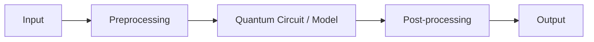

<div align="center">

# Kitrockz

**VTU-QFF-HC-0031** &nbsp;|&nbsp; Tier: **Both**

</div>

---

<div align="center">

| | |
| :--- | :--- |
| **Team** | Kitrockz |
| **Team ID** | VTU-QFF-HC-0031 |
| **Tier** | Both |
| **Repository** | [vtu-hc-kitrockz](https://github.com/vtu-qiskit-fall-fest-2026/vtu-hc-kitrockz.git) |
| **Organisation** | [vtu-qiskit-fall-fest-2026](https://github.com/vtu-qiskit-fall-fest-2026) |
| **Event** | VTU-QFF Hackathon — VTU-Qiskit Fall Fest 2026 |

</div>

---

## 📌 Table of Contents

- [Team Members](#-team-members-github-ids)
- [Problem Statement](#-problem-statement)
- [Proposed Solution](#-proposed-solution)
- [Approach & Architecture](#-approach--architecture)
- [Tech Stack](#-tech-stack)
- [Project Structure](#-project-structure)
- [How to Run](#-how-to-run)
- [How to Push Code](#-how-to-push-code)
- [Submission Checklist](#-submission-checklist)
- [Resources](#-resources)
- [License](#-license)

---

## 👥 Team Members (GitHub IDs)

> Members are added to this repository as **collaborators** and must accept the
> GitHub invitation before they can push. Add your GitHub username below.

| # | Name | GitHub Username | Role |
| :-- | :--- | :--- | :--- |
| 1 | RITIK KAMBLE | Ritik-006 | _Team Lead_ |
| 2 | PARASHARAM VADDAR | Parasharam-hash | _Developer_ |
| 3 | PRASHANTH KUTRE | prashanthkutre9-gif | _Developer_ |

<!--
Optional: add a plain list instead of the table above.
- @username1
- @username2
-->

---

## ❓ Problem Statement

<!--ScamShield AI
Intelligent Digital Fraud Detection & Protection System
"Develop an AI-powered digital security platform that detects and explains potential online scams by analyzing suspicious messages, phishing URLs, and fraudulent communication using machine learning and hybrid quantum-classical classification techniques."
-->


**Problem:** _Online scams, phishing links, and fraudulent messages are increasing, putting users’ personal and financial information at risk. ScamShield AI aims to detect and explain these threats using artificial intelligence and machine learning, helping users identify scams and stay safe online.._

**Why it matters:** _ScamShield AI helps prevent financial losses, protect personal information, and increase awareness of online fraud. It provides an opportunity to make digital communication safer by detecting scams early and helping users make informed decisions.._

**Track / Category:** _Online / Offline · Track 1 / Track 2 · <domain>_

---

## 💡 Proposed Solution

<!--ScamShield AI – Proposed Solution

ScamShield AI is an intelligent fraud detection platform that analyzes suspicious messages, phishing URLs, and online communications to identify potential scams and protect users’ personal and financial information.

- AI-Powered Detection: Uses NLP and machine learning (Random Forest) to identify fraudulent patterns.
- Instant Risk Assessment: Classifies content as safe, suspicious, or potentially fraudulent and generates a risk score.
- Explainable AI: Highlights warning signs and explains why a message or link may be dangerous.
- Hybrid Quantum-Classical Classification: Explores quantum machine learning combined with classical algorithms to improve fraud detection.
- Simple User Flow: Users paste a message or URL and receive a quick analysis, risk score, and actionable safety guidance.
-->

**Solution:** _ScamShield AI is an AI-powered platform that detects online scams, phishing URLs, and fraudulent messages using NLP and machine learning, providing instant risk scores and clear explanations of potential threats. It combines classical ML techniques with an experimental hybrid quantum-classical classifier to support smarter fraud detection and help users make safer digital decisions.._

**Key idea:** _ScamShield AI combines NLP, machine learning, and hybrid quantum-classical classification to detect digital fraud, assess scam risks, and deliver explainable real-time security alerts.._

**Why this works:** _ScamShield AI identifies suspicious patterns in messages and URLs, helping detect potential fraud before users interact with dangerous content. By combining AI-based analysis with explainable risk scores and warnings, it enables users to recognize threats early and make safer digital decisions.._

---

## 🧩 Approach & Architecture

<!--## Approach & Architecture – ScamShield AI

ScamShield AI follows a modular architecture that processes user-submitted messages and URLs through data preprocessing, feature extraction, and AI-based classification. NLP and Random Forest models detect suspicious patterns, while a hybrid quantum-classical model is explored for advanced classification. The results are presented through a user-friendly dashboard with risk scores, threat explanations, and safety recommendations.

Workflow: User Input → Preprocessing → Feature Extraction → ML & Quantum-Classical Classification → Risk Scoring → Explainable Alerts & Recommendations.
-->



1. **Input** — _Suspicious messages, phishing URLs, and email text are accepted as input._
2. **Preprocessing** — _The system cleans the text, extracts important features, and converts data into a suitable numerical format._
3. **Quantum core** — _A Variational Quantum Circuit (VQC) combined with machine learning analyzes patterns to classify potential scams._
4. **Post-processing** — _The system interprets model results, calculates a risk score, and identifies potential threats._
5. **Output** — _Users receive a scam detection result, risk level, explanation, and safety recommendations._

---

## 🛠️ Tech Stack

| Layer | Technology |
| :--- | :--- |
| Language | Python 3.11+ |
| Quantum SDK | Qiskit `>=1.0`, Qiskit Aer, Qiskit Runtime |
| Optimisation | Qiskit Optimization / COBYLA / SPSA |
| Simulation | AerSimulator (statevector / noisemodel) |
| Environment | JupyterLab / VS Code, `venv` |
| Version control | Git + GitHub |

---

## 📁 Project Structure

```text
vtu-hc-kitrockz/
├── README.md              # This file
├── requirements.txt       # Python dependencies
├── pyproject.toml         # Project metadata (optional)
├── .gitignore
├── notebooks/             # Jupyter notebooks for experiments
│   └── exploration.ipynb
├── src/
│   ├── __init__.py
│   ├── circuit.py         # Quantum circuit construction
│   ├── optimizer.py       # Optimization loop
│   └── main.py            # Entry point
├── data/                  # Datasets (use Git LFS for large files)
├── tests/                 # Unit tests
│   └── test_circuit.py
└── docs/                  # Notes, diagrams, reports
```

---

## 🚀 How to Run

### Prerequisites

- Python 3.11 or newer
- [Git](https://git-scm.com/downloads)
- A GitHub account (you need collaborator access to this repo)

### 1. Clone the repository

```bash
git clone https://github.com/vtu-qiskit-fall-fest-2026/vtu-hc-kitrockz.git
cd vtu-hc-kitrockz
```

### 2. Create a virtual environment

```bash
python3 -m venv .venv
source .venv/bin/activate        # Linux / macOS
# .venv\Scripts\activate         # Windows (PowerShell)
```

### 3. Install dependencies

```bash
pip install --upgrade pip
pip install -r requirements.txt
```

### 4. Run

```bash
python -m src.main
```

Or launch the notebook workflow:

```bash
jupyter lab
```

### 5. Run the tests

```bash
pytest -q
```

---

## 🔁 How to Push Code

> Full walkthrough: **[Git & Collaboration Handbook](../vtu-hc-guide-git-and-collaboration)** — collaboration
> workflow, branches, pull requests, reviews and conflict resolution.

### Configure Git (first time only)

```bash
git config --global user.name  "Your Name"
git config --global user.email "you@example.com"
```

### Everyday workflow

```bash
# 1. Get the latest changes
git checkout main
git pull origin main

# 2. Create a branch for your work
git checkout -b feature/my-task

# 3. Commit your work
git add .
git commit -m "feat: add variational circuit for the search problem"

# 4. Push the branch
git push -u origin feature/my-task

# 5. Open a Pull Request on GitHub and request a review
#    https://github.com/vtu-qiskit-fall-fest-2026/vtu-hc-kitrockz/compare/main...feature/my-task

# 6. After approval, merge into main
git checkout main
git pull origin main
git branch -d feature/my-task
```

### Commit message convention

| Prefix | Meaning |
| :--- | :--- |
| `feat:` | New feature |
| `fix:` | Bug fix |
| `docs:` | Documentation only |
| `test:` | Adding or fixing tests |
| `refactor:` | Code restructure, no behaviour change |
| `chore:` | Build/config/dependency changes |

### Useful commands

```bash
git status              # what changed
git log --oneline -10   # recent commits
git diff                # review changes before committing
git stash               # shelve changes temporarily
git pull --rebase       # update your branch on top of main
```

### Collaborating on the same repo

- **Never push directly to `main`** — open a Pull Request.
- **Pull before you push** to avoid rejected commits.
- **Commit often** with clear messages.
- **Resolve conflicts** locally: `git pull --rebase`, fix the files, then `git add` + `git rebase --continue`.
- **Ask for a review** before merging — a second pair of eyes catches bugs fast.

---

## ✅ Submission Checklist

- [ ] Repository created and **public**
- [ ] All team members added as **collaborators** and invitations accepted
- [ ] `README.md` updated with project details, problem statement and solution
- [ ] Team members listed under [Team Members](#-team-members-github-ids)
- [ ] `requirements.txt` committed and project runs from a clean clone
- [ ] Code pushed to `main` and the latest `main` builds successfully
- [ ] Notebooks committed with **cleared outputs** (or use `nbstrip`)
- [ ] `README` includes a demo screenshot / video link
- [ ] Short project summary submitted on the hackathon portal

---

## 📚 Resources

| Resource | Link |
| :--- | :--- |
| 🔁 Git & collaboration handbook | [Git & Collaboration Handbook](../vtu-hc-guide-git-and-collaboration) |
| ❓ Problem statements, solutions & terms | [Problem Statements, Solutions & Terms](../vtu-hc-guide-problem-and-solution) |
| 📄 README writing guide | [README Guide & Template](../vtu-hc-guide-readme-template) |
| ⚛️ Qiskit documentation | https://docs.quantum.ibm.com/ |
| ⚛️ Qiskit Runtime & primitives | https://quantum.cloud.ibm.com/docs/ |
| 🧪 Qiskit Aer simulator | https://docs.quantum.ibm.com/guides/simulator |
| 💻 IBM Quantum Platform | https://quantum.cloud.ibm.com/ |
| 🎓 Qiskit textbook | https://qiskit.qotlabs.org/learning/ |
| 📋 GitHub Docs | https://docs.github.com/ |

---

## 📄 License

Released under the [MIT License](LICENSE). See `LICENSE` for details.

---

<div align="center">

**Kitrockz** · Team ID `VTU-QFF-HC-0031` · Tier `Both`
· Built with ⚛️ Qiskit for the VTU-QFF Hackathon

[⬆ Back to Top](#kitrockz)

</div>
